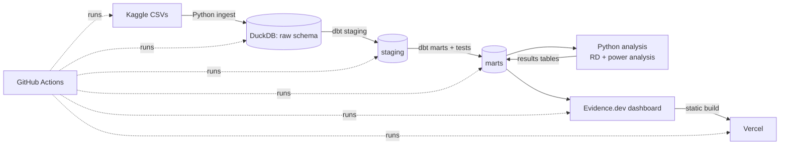

# E-Commerce Analytics Warehouse — Project Plan

## In one sentence

Take ~100K real orders from a Brazilian online marketplace (Olist), organize them into a clean, tested data warehouse, measure how the merchants on it are doing, and answer one business question with evidence: **does a late delivery cause worse reviews, and by how much?**

## Why this project

It closes the three biggest gaps between my resume and data internship postings (written against Shopify's Data Internship, Summer 2027):

| Gap | What closes it |
|---|---|
| Warehouse modelling (Data Engineering track) | dbt staging → mart layers with automated data-quality tests |
| Product / commerce analytics | Merchant-facing metrics: GMV, AOV, retention, delivery, reviews |
| Experimentation & causal inference (Product Data Science track) | Regression discontinuity analysis + a pre-registered experiment design with power analysis |

Olist is a marketplace for small sellers, so its sellers map directly onto Shopify merchants. Everything is framed from the merchant's point of view.

---

## 1. Data

**Source:** [Brazilian E-Commerce Public Dataset by Olist](https://www.kaggle.com/datasets/olistbr/brazilian-ecommerce) (Kaggle), ~100K orders, 2016–2018.

Tables used:

| File | Grain |
|---|---|
| `olist_orders_dataset` | one row per order (status + purchase / delivered / **estimated delivery** timestamps) |
| `olist_order_items_dataset` | one row per item in an order (seller, price, freight) |
| `olist_order_payments_dataset` | one row per payment |
| `olist_order_reviews_dataset` | one row per review (1–5 score, dates) |
| `olist_customers_dataset` | customer + location |
| `olist_sellers_dataset` | seller + location |
| `olist_products_dataset` | product attributes |
| `product_category_name_translation` | Portuguese → English categories |
| `olist_geolocation_dataset` | zip prefix → lat/lng (optional) |

**Rules**
- Raw CSVs are **not committed** (`data/raw/` is git-ignored). They are downloaded with the Kaggle CLI (locally, and in CI via `KAGGLE_USERNAME` / `KAGGLE_KEY` secrets).
- Check the dataset's license on the Kaggle page and add the required attribution to the README and dashboard footer.

---

## 2. Architecture



### Stack

| Layer | Tool | Why |
|---|---|---|
| Storage / query engine | **DuckDB** | Free, local, fast; already used in Sentiment Radar |
| Transformation | **dbt Core + dbt-duckdb** | Industry-standard warehouse modelling; Shopify builds its warehouse with dbt |
| Analysis | **Python** (pandas, statsmodels, `rdrobust`) | RD estimation, power analysis |
| Dashboard | **Evidence.dev** | SQL + Markdown BI that builds to a **static site** — no server, so it never sleeps |
| Hosting | **Vercel** (Hobby, free) | Serves the static build from a CDN; no cold starts or inactivity sleep |
| CI/CD | **GitHub Actions** | Ingest → `dbt build` → analysis → Evidence build → deploy on every push to `main` |

### Why Evidence + Vercel instead of Streamlit

Streamlit Community Cloud runs a live Python server, which is put to sleep after inactivity. Evidence **pre-runs all SQL at build time** and outputs plain HTML/JS plus small Parquet data files, so the deployed site is just static files on a CDN: always on, loads instantly, free.

Trade-off: data is frozen at build time. That's fine here — Olist is historical, so the site only needs rebuilding when the code changes.

Fallbacks if Vercel ever doesn't fit: Netlify or GitHub Pages (both free static hosting). Cloudflare Pages has a 25 MB per-file limit, so check the Parquet sizes before using it.

---

## 3. Repo structure

```
ecom-analytics-warehouse/
├── README.md
├── PLAN.md
├── data/
│   └── raw/                  # git-ignored; Kaggle CSVs
├── ingest/
│   └── load_raw.py           # CSVs -> DuckDB raw schema
├── warehouse/                # dbt project
│   ├── dbt_project.yml
│   ├── profiles.yml          # dbt-duckdb, path from env var
│   └── models/
│       ├── staging/          # stg_* — one per raw table
│       ├── intermediate/     # int_* — joins / reusable logic
│       └── marts/            # fct_* / dim_* / metric tables
├── analysis/
│   ├── rd_late_delivery.py   # regression discontinuity
│   ├── power_analysis.py     # experiment sizing
│   └── memo.md               # one-page decision memo
├── reports/                  # Evidence project
│   ├── sources/warehouse/    # DuckDB source + queries
│   └── pages/                # dashboard pages (.md)
└── .github/workflows/
    └── build-deploy.yml
```

---

## 4. Data model (dbt)

### Staging (`stg_*`)
One model per raw table. Only: rename to snake_case English, cast types, parse timestamps, standardize category names. No joins, no business logic.

### Intermediate (`int_*`)
- `int_order_items_enriched` — items + product category + seller
- `int_order_delivery` — per order: `days_vs_estimate = delivered_date − estimated_date` (negative = early), `is_late`
- `int_order_reviews_dedup` — one review per order (rule for duplicates documented)

### Marts
| Model | Grain | Purpose |
|---|---|---|
| `fct_orders` | order | revenue, freight, item count, delivery timing, review score |
| `fct_order_items` | order item | item-level revenue by seller/category |
| `dim_sellers` | seller | location, first/last sale, lifetime GMV |
| `dim_customers` | customer (`customer_unique_id`) | location, order count, first order |
| `mart_seller_monthly` | seller × month | GMV, orders, AOV, on-time rate, avg review |
| `mart_seller_cohorts` | first-sale cohort × months since | seller retention |
| `mart_delivery_reviews` | day offset from estimate | input table for the RD analysis |

### Data-quality tests
- `unique` + `not_null` on every primary key
- `relationships` (e.g. every `fct_order_items.order_id` exists in `fct_orders`)
- `accepted_values` on `order_status`
- Range checks: review score 1–5, price ≥ 0, delivered date ≥ purchase date
- Row-count reconciliation between raw and staging

Gotcha to document: Olist has both `customer_id` (per order) and `customer_unique_id` (per person). Repeat-purchase metrics must use `customer_unique_id`.

---

## 5. Metric definitions

Write every definition in the dbt model docs, including the alternatives I rejected and why.

| Metric | Definition |
|---|---|
| **GMV** | Sum of item `price` for delivered orders (freight excluded; state this) |
| **AOV** | GMV ÷ number of delivered orders |
| **On-time delivery rate** | Share of delivered orders with `delivered_date ≤ estimated_date` |
| **Avg review score** | Mean 1–5 score per order, one review per order |
| **Repeat purchase rate** | Share of customers (`customer_unique_id`) with ≥ 2 delivered orders within 180 days of their first |
| **Seller retention (month k)** | Of sellers whose first sale was in month *m*, the share with ≥ 1 sale in month *m + k* |

---

## 6. Causal analysis — does late delivery cause worse reviews?

**Why not just compare late vs on-time orders?** That's confounded: sellers who ship late probably differ in other ways too (product quality, distance, category).

**Design: regression discontinuity (RD).**
- Every order has a promised (estimated) delivery date, so "late" is a sharp threshold.
- **Running variable:** `days_vs_estimate` (cutoff at 0).
- **Outcome:** review score (also try P(1-star review)).
- Orders delivered 1 day before vs 1 day after the promise should be nearly identical except for being late, so the **jump at the cutoff** estimates the causal effect of lateness.

**Method**
1. Plot average review score by `days_vs_estimate` (binned) — the jump should be visible.
2. Estimate with local linear regression on each side of the cutoff (`rdrobust`, data-driven bandwidth).
3. Robustness:
   - Vary the bandwidth (half / double) and report how stable the estimate is
   - Placebo cutoffs (e.g. −5, +5 days) should show no jump
   - Bunching check: are there suspiciously many orders just before the cutoff? (sign of estimate manipulation)
   - Covariate balance: price, freight, distance, category should *not* jump at the cutoff

**Limitations to state up front**
- The running variable is in whole days (discrete), so the estimate relies on the bins nearest the cutoff
- Sellers / Olist may set estimates strategically
- Some reviews may be written before delivery; filter or flag these
- Result is the effect *at the threshold* (just-late vs just-on-time), not the effect of being 10 days late

---

## 7. Experiment design (A/B test plan)

I can't run a real experiment on historical data, so this is an honest **design** using real baselines.

**Hypothetical test:** "Showing a more conservative (later) estimated delivery date raises review scores." (Motivated directly by the RD result.)

Write `analysis/experiment_design.md` covering:
- **Unit of randomization:** order (or customer — justify the choice)
- **Primary metric:** 5-star review rate. **Guardrail:** conversion / checkout rate (a later promise might scare buyers off)
- **Power analysis:** with the real Olist baseline 5-star rate, how many orders per arm to detect a +X percentage-point lift at α = 0.05, 80% power (`statsmodels.stats.power`)
- **Sample-ratio mismatch (SRM) check:** a chi-square test that the observed traffic split matches the intended 50/50; if it fails, randomization is broken and results can't be trusted
- **Decision rule** written *before* looking at results

Label all of this clearly as a design, not a run test.

---

## 8. Dashboard (Evidence.dev → Vercel)

| Page | Content |
|---|---|
| **Overview** | GMV, orders, AOV, on-time rate over time |
| **Merchants** | Seller leaderboard, seller cohort retention heatmap, filter by state/category |
| **Delivery & Reviews** | Review score by days vs estimate (the RD plot), on-time rate by state |
| **Findings** | The decision memo: result, confidence interval, limitations, recommended experiment |

The Findings page is what makes this product data science rather than just a dashboard.

---

## 9. CI/CD (`.github/workflows/build-deploy.yml`)

On push to `main`:
1. Set up Python + Node
2. Download Olist data with the Kaggle CLI (secrets: `KAGGLE_USERNAME`, `KAGGLE_KEY`)
3. `python ingest/load_raw.py`
4. `dbt build` (runs models **and** tests; pipeline fails if a test fails)
5. Run analysis scripts → write results tables into DuckDB
6. Evidence: `npm run sources && npm run build` → static site in `reports/build/`
7. Deploy the prebuilt `build/` folder to Vercel with the Vercel CLI (secret: `VERCEL_TOKEN`)

Building in Actions and pushing the finished static site means Vercel never needs access to the data or the Kaggle credentials.

---

## 10. Milestones

### Weekend 1 — Warehouse
- [ ] Repo, `.gitignore`, Kaggle download script
- [ ] `load_raw.py` → DuckDB raw schema
- [ ] All staging models + tests
- [ ] `fct_orders`, `dim_sellers`, `dim_customers`, `int_order_delivery`
- [ ] `dbt build` passes locally

### Weekend 2 — Metrics, analysis, ship (= MVP)
- [ ] `mart_seller_monthly`, `mart_seller_cohorts`, `mart_delivery_reviews`
- [ ] Metric definitions written in dbt docs
- [ ] RD analysis + robustness checks
- [ ] One-page decision memo
- [ ] Evidence dashboard (4 pages), deployed to Vercel
- [ ] GitHub Actions pipeline green
- [ ] README: what, why, architecture diagram, how to run, live link

**MVP = enough to replace the Home Credit project on the resume.**

### Stretch
- [ ] Experiment design doc + power analysis
- [ ] Reusable A/B analysis module (power, SRM, bootstrap CIs, CUPED), validated on the Cookie Cats public A/B dataset
- [ ] Seller acquisition funnel using Olist's companion Marketing Funnel dataset (joins on `seller_id`)
- [ ] Move the warehouse to BigQuery

---

## 11. Resume entry (fill in real numbers after building)

**E-Commerce Analytics Warehouse** | Python, SQL, dbt, DuckDB, Evidence, GitHub Actions
- Modelled **[N]K marketplace orders** into a **dbt** warehouse with [N] staging/mart models and [N] automated **data-quality tests**, run in CI with GitHub Actions.
- Estimated the causal effect of late delivery on merchant review scores with a **regression discontinuity** design ([result]), publishing merchant KPIs in a static **Evidence** dashboard on Vercel.

Don't write a result until it exists.

---

## 12. Interview prep — questions to be ready for

- Why did you structure the models into staging / intermediate / marts?
- How did you define repeat purchase rate, and what alternatives did you reject?
- Why `customer_unique_id` instead of `customer_id`?
- Why regression discontinuity instead of comparing late vs on-time orders?
- What would invalidate your RD result? What did the placebo and bunching checks show?
- What experiment would you run next, how many orders would it need, and what's your guardrail metric?
- Why Evidence/static hosting instead of a live app? What's the trade-off?
