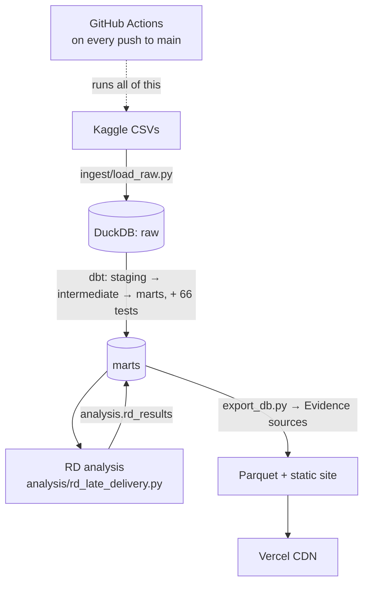

# E-Commerce Analytics Warehouse

**Live dashboard: https://ecom-analytics-warehouse.vercel.app**

~100K real orders from Olist, a Brazilian marketplace for small sellers, modelled into a tested
dbt + DuckDB warehouse. It produces merchant KPIs (GMV, AOV, on-time delivery, reviews, seller
retention) and answers one question with a causal design:

> **Does late delivery cause worse reviews, and by how much?**
>
> Yes, but through *how late* the order is, not through missing the promised date by itself.
> Each extra day past the promise costs **0.62 stars** (95% CI 0.52–0.73) compared with the trend
> before it. Just crossing the promised date changes the average score by −0.03 (CI −0.18 to
> +0.12, not significant), though the 5-star share dips by 7.9 pp.
> ([full memo](analysis/memo.md))

## Architecture



| Layer | Tool |
|---|---|
| Storage / query engine | DuckDB |
| Transformation + data tests | dbt Core (dbt-duckdb) |
| Analysis | Python: pandas, statsmodels, `rdrobust` |
| Dashboard | Evidence (open-source v40, a static build) |
| Hosting | Vercel (static files, no server) |
| CI/CD | GitHub Actions: download → `dbt build` → analysis → build → deploy |

## The warehouse

**19 models, 66 tests** (`dbt build` runs both and fails the pipeline on any failed test).

| Layer | Models | What it does |
|---|---|---|
| `staging` (views) | 9 × `stg_*` | One per raw table: rename and cast only. Raw is loaded as text so zip codes keep their leading zeros |
| `intermediate` (views) | `int_order_items_enriched`, `int_order_delivery`, `int_order_reviews_dedup` | Shared logic: English categories, days vs promised date, one review per order |
| `marts` (tables) | `fct_orders`, `fct_order_items`, `dim_sellers`, `dim_customers`, `mart_seller_monthly`, `mart_seller_cohorts`, `mart_delivery_reviews` | What the dashboard and analysis query |

Tests cover:
- primary keys, including composite ones
- relationships between tables
- accepted values
- range checks, through a custom `expression_is_true` generic test
- a row-count reconciliation from raw to models

Every metric is defined once, with the alternatives that were rejected, in
[`models/marts/metrics.md`](warehouse/models/marts/metrics.md):

| Metric | Definition |
|---|---|
| GMV | Sum of item price on delivered orders (freight excluded) |
| AOV | GMV ÷ delivered orders |
| On-time rate | Delivered **date** ≤ promised date |
| Avg review | One review per order (the most recently answered one) |
| Repeat purchase | Another delivered order placed more than 24h and at most 180 days after the first, per `customer_unique_id`. Censored customers are excluded |
| Seller retention (k) | Share of a first-sale cohort with a sale exactly k months later |

Data quirks the models handle:
- `customer_id` is issued per order, so people are tracked with `customer_unique_id`.
- `review_id` isn't unique.
- 28% of "repeat" orders are a single cart that was split up.
- Order status and delivery date disagree on 14 orders.

## The analysis

A **regression discontinuity** at the promised delivery date, run on 95,824 delivered and
reviewed orders. Local linear fits with `rdrobust`, a data-driven bandwidth, robust
bias-corrected CIs, and errors clustered by seller. Alongside the main estimate, it checks:
- a kink (slope-change) estimate
- covariate balance
- placebo cutoffs
- bandwidth sensitivity
- a bunching test

The memo reports the failures as well as the passes. Deliveries **bunch** just before the
promise (36% fewer orders just after it than the trend predicts), the +5-day placebo fails where
the curve flattens, and freight is borderline imbalanced. See [`analysis/memo.md`](analysis/memo.md).

## Run it locally

Needs Python 3.13, Node 18+, and a Kaggle API token.

```bash
py -3.13 -m venv .venv                       # macOS/Linux: python3.13 -m venv .venv
.venv/Scripts/pip install -r requirements.txt  # macOS/Linux: .venv/bin/...
.venv/Scripts/kaggle auth login              # or set KAGGLE_API_TOKEN

.venv/Scripts/python ingest/load_raw.py      # download + load raw (≈1 min)
cd warehouse && ../.venv/Scripts/dbt build && cd ..
.venv/Scripts/python analysis/rd_late_delivery.py
.venv/Scripts/python reports/export_db.py

cd reports && npm install && npm run sources && npm run dev
```

The DuckDB file is written to `data/warehouse.duckdb`, or to `WAREHOUSE_PATH` if that's set.
To query it ad hoc:
```bash
cd warehouse && ../.venv/Scripts/dbt show --inline "select * from marts.fct_orders" --limit 10
```

## Repo layout

```
ingest/       load_raw.py: Kaggle → DuckDB raw schema
warehouse/    dbt project (models/, macros/, tests/)
analysis/     rd_late_delivery.py, memo.md
reports/      Evidence dashboard (pages/, sources/, export_db.py)
.github/      build-deploy.yml
PLAN.md       original plan · PROGRESS.md work log · CHECKS.md how to verify each phase
```

## Design notes

- **Why legacy Evidence:** current Evidence ("Evidence Studio") is a hosted product with no static
  build, so this project pins open-source Evidence v40. Its connector uses DuckDB 1.4, so
  `export_db.py` writes a copy of the marts in the 1.4 storage format.
- **Why static hosting:** all SQL runs at build time. The site is HTML, JS and about 130 KB of
  Parquet on a CDN, so it never sleeps and needs no credentials at runtime.

## Data & license

Data: [Brazilian E-Commerce Public Dataset by Olist](https://www.kaggle.com/datasets/olistbr/brazilian-ecommerce),
by Olist, licensed [CC BY-NC-SA 4.0](https://creativecommons.org/licenses/by-nc-sa/4.0/).
Derived tables and dashboard data in this project are shared under the same license, for
non-commercial use. Raw data is not committed.
